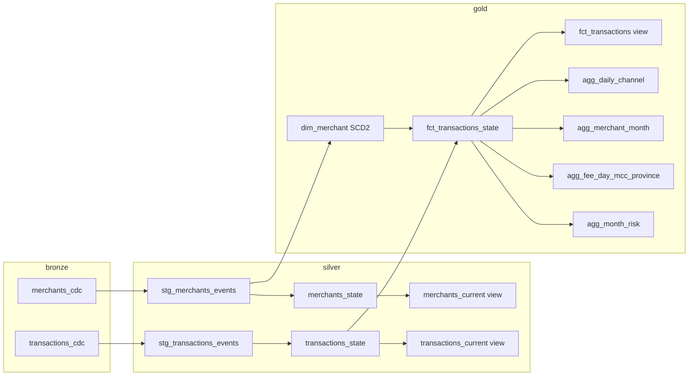

# Data model and layer rules

## Flow (medallion layers)

```
Postgres core.*  --Debezium/Kafka-->  bronze  --dbt-->  silver  --dbt-->  gold  --> Metabase (gold only)
                  (ingestion plane)    CDC log           clean, current     business model
                                       (ClickHouse        state, no clear-text PII  + serving aggregates
                                        Kafka engine)
```



## Layer rules

| Layer | What it holds | Allowed | Not allowed |
|---|---|---|---|
| **bronze** | One append-only table per source table: Kafka offset, op (r/c/u/d), Postgres LSN, full JSON payload. The only place with personal data in clear text. | Insert only, by ClickHouse's own Kafka consumer | Parsing, business rules, updates, deletes, TTL, access by dashboards or by dbt writes |
| **silver** | Typed, de-duplicated events; versioned current state; owner identity as HMAC tokens | Typing, de-duplication, hashing/masking, "latest version wins" | Joins between tables, business rules, personal data in clear text |
| **gold** | SCD2 merchant dimension, transaction fact, serving aggregates | Joins, point-in-time logic, metric definitions, aggregation; documented pseudonymous tokens are still sensitive | Direct identifiers, raw events |

Naming: `stg_*` typed event log, `*_state` versioned physical table (ReplacingMergeTree), views without suffix
(`*_current`, `*_events`, `fct_transactions`, `agg_*`) read the latest version with `FINAL`. Always query the views.

## Grain of every table (and why)

| Table | Grain | Why this grain |
|---|---|---|
| `silver.stg_*_events` | one row per change event (key, LSN, op) | Lossless history; the basis of both the current state and the SCD2 dimension |
| `silver.*_state` / `*_current` | one row per merchant / transaction (latest version) | "Current status of every record is correct", incl. hard deletes |
| `gold.dim_merchant` | one row per merchant per version | Lets a transaction be joined to the merchant as it was at transaction time (SCD Type 2) |
| `gold.fct_transactions` | one row per transaction | The atomic fact; carries province / risk level / mcc valid at `created_at` |
| `gold.agg_daily_channel` | Tehran day x channel | Cards 1 and 2 |
| `gold.agg_merchant_month` | Tehran month x merchant | Card 3 |
| `gold.agg_fee_day_mcc_province` | Tehran day x MCC x province at transaction time | Card 4 |
| `gold.agg_month_risk` | Tehran month x risk level at transaction time | Card 5 |

## How correctness is achieved

* **Ordering / versions**: for one key, a row's version is `(source_lsn, kafka_offset)`; two transactions cannot change the same row at once, so LSN order is commit order. One Kafka partition per table keeps arrival order.
* **Duplicates**: Debezium is at-least-once and every run re-reads a small overlap. Event identity is `(key, LSN, op)`; ReplacingMergeTree + `FINAL` keeps one row. All steps are idempotent.
* **Deletes**: a delete event has only the key (other fields are placeholders). Silver keeps the last known values of the key and writes `is_deleted = 1`; the row disappears from `*_current` and from the fact, the event stays in the event log.
* **Incremental**: each model reads only offsets after its own watermark (minus the overlap), at most `max_batch_events` per run. Aggregates recompute only the days/months in which the fact changed. `dim_merchant` (about 5,000 events) is rebuilt in full each run; it is the one deliberate exception.
* **Point in time**: `fct_transactions` joins `created_at` to `dim_merchant.valid_from` with an ASOF join. A NEW dimension version triggers re-assignment of that merchant's transactions from the version's `valid_from` onwards.
* **Time**: days are Asia/Tehran days, months Gregorian months in Asia/Tehran, computed once in the fact (`txn_date`, `txn_month`), so no tool has to convert time zones.
* **Personal data**: owner national id and mobile only as HMAC-SHA256 tokens (secret key in a Docker volume, key pads in `ops.pii_pads`, never in SQL text or logs) plus a masked mobile.

## Known limitations (stated, not hidden)

* Merchant versions that appear in silver with a lower Kafka offset than versions already processed (a row becoming visible out of order) would not trigger the re-assignment of existing facts. The overlap re-read makes this very unlikely; a periodic consistency sweep would remove it.
* Groups that vanish completely are overwritten with zero rows and hidden by the views.
* `TRUNCATE` on the source is not captured. Merchant deletes are not modelled (the dimension keeps history).
* A very long outage (longer than Kafka's 3-day retention) loses events that bronze did not receive in time; a Debezium incremental snapshot only re-sends CURRENT rows, never past versions or deleted rows.
* Bronze keeps clear-text owner identifiers and has no TTL; see `governance.md`.